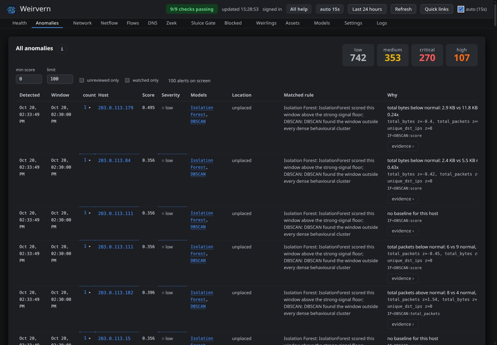
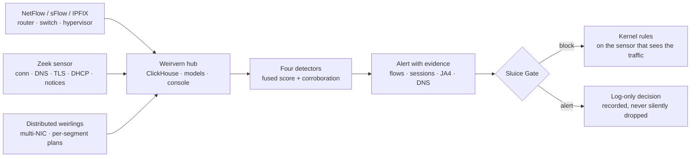

<p align="center">
  
</p>

<h1 align="center">Weirvern</h1>

<p align="center">
  <strong>See the network. Prove the anomaly. Block the traffic.</strong>
</p>

<p align="center">
  ML-backed network detection and enforcement, <strong>built in Kubernetes for easy
  deployment</strong>. Weirvern learns from <strong>NetFlow, Zeek, DNS and JA4</strong>
  fingerprints, explains every alert with the measurements behind it, and can sit
  <strong>inline to inspect and drop traffic</strong>, redirect a segment with <strong>ARP</strong>,
  or watch passively from a mirror.
</p>

<p align="center">
  <code>inline bridge</code> · <code>ARP redirection</code> · <code>passive mirror</code> ·
  <code>distributed weirlings</code> · <code>NetFlow · Zeek · DNS · JA4</code> · <code>kernel blocking</code>
</p>

<p align="center">
  Current release: <strong>0.20.1</strong> · MIT · flow and protocol metadata only; payloads are never inspected
</p>

<p align="center">
  <a href="https://github.com/hodlhart/weirvern/actions/workflows/ci.yml"></a>
  <a href="https://github.com/hodlhart/weirvern/releases"></a>
  <a href="LICENSE"></a>
  <a href="https://kubernetes.io/"></a>
  <a href="SECURITY.md"></a>
</p>

<p align="center">
  <a href="#quick-start">Quick start</a> ·
  <a href="#screenshots">Screenshots</a> ·
  <a href="docs/architecture.md">Architecture</a> ·
  <a href="docs/deployment.md">Deploy</a> ·
  <a href="docs/detection.md">Detection</a> ·
  <a href="docs/operations.md">Operations</a>
</p>



## What you get

**An answer, not just an alert.** Every anomaly carries the measurements that produced it — the
z-scores, the baseline, the model votes and the raw flows, Zeek sessions, TLS records and DNS
answers behind the window. Click an alert and the evidence is on the same screen.

**Four detectors, one verdict.** Isolation Forest, Gradient Boosting, DBSCAN and a per-host
adaptive baseline are trained independently and fused into one score. A corroboration gate
decides when the ensemble is confident enough to raise severity. ATT&CK techniques appear as
hypotheses with their measurements, never as bare conclusions.

**Sensors where the network is.** A hub runs the database, models and the console; a weirling is
the sensor you place on a host or node anywhere in the infrastructure. It can carry several NICs,
each bound to a different segment with its own capture, redirect and blocking plan. See
[Weirlings: one hub, sensors throughout the infrastructure](#weirlings-one-hub-sensors-throughout-the-infrastructure).

**Inline when you need it.** Put two NICs in a bridge and the box becomes the wire: traffic
passes through, Zeek sees the protocol layer, and the Sluice Gate can drop a packet at the kernel.
No host agents, no SPAN port, no re-architecture. Or redirect a segment with ARP for a bounded
intercept, or stay passive on a mirror.

**Enforcement with a paper trail.** The Sluice Gate compiles rules to the kernel only where it can
actually see the traffic. Every block names its source, destination, direction, duration and
reason; every alerting decision — sent, suppressed or log-only — is recorded.

**No payload inspection.** Weirvern reads flow records and Zeek metadata. TLS still authenticates
end to end. Nothing is decrypted, and nothing is probed.

## Weirlings: one hub, sensors throughout the infrastructure

A weirling is a sensor, not a remote-agent afterthought. The hub can run with no capture NIC at
all; each weirling registers with it, reports its health, interfaces and flow feed, and receives
its own plan. Deploy as many as the infrastructure needs — one per rack, one per site, one per
isolated segment.

**Each NIC is planned independently.** A single weirling can have several NICs on different
segments, and each one carries its own roles:

- **capture** — mirror/SPAN/TAP traffic into Zeek for that segment
- **siphon** — ARP redirect on that NIC's segment, with its own routing table and gateway
- **sluice** — kernel blocking rules on that NIC, with its own nftables table pair
- **management** — refused for every active role, so the console path is never intercepted

One NIC's plan never overwrites another's. A weirling with one NIC on VLAN 21 and another on a
separate segment can watch one, redirect the other, or block on either independently. Add more
weirlings and the same per-NIC model extends across racks, sites and networks that do not route to
each other.

The fleet view keeps the facts separate: registered, silent, never-seen and revoked are different
states; every row shows its mode, networks, flow trend and NetFlow/Zeek feed indicators, with each
NIC's role on its own line. Revoking a weirling clears its plans and settings, so re-adopting it
starts clean rather than inheriting the old cross-segment roles.

## Screenshots

Every image is the shipping console rendered against synthetic, RFC 5737 documentation addresses.
No address from a real network appears in any screenshot.


The connection map is a deterministic force layout: nodes are hosts, edges are conversations,
size is bytes, and hop rings come from measured IP TTL where the export carries it. Click a node
to track it; click an edge for its exact source, destination and ports.

## How it works



The hub needs no capture NIC. A sensor can watch a copy (`loch`), redirect a segment with ARP
(`siphon`), or sit in-line as a bridge (`channel`). Only the in-path shapes can enforce; the
console says `degraded` rather than pretending when a mirror port cannot drop anything.

| Placement | What it needs | Can enforce? | Best for |
|---|---|---|---|
| **`loch`** — mirror / SPAN / TAP | 1 capture NIC, `NET_RAW` | No | Safe observation; the default |
| **`siphon`** — ARP redirect | 1 NIC on the segment, `NET_ADMIN` | Yes, while a supervised intercept is live | A flat segment or VLAN under investigation |
| **`channel`** — in-line bridge | 2 NICs (upstream + downstream), `NET_ADMIN` | Yes, continuously | A segment uplink you can route through the box |

The same image runs every shape; the placement is a setting, not an install. See
[Architecture](docs/architecture.md) for the full model and [Deployment](docs/deployment.md) for
the manifests, capabilities and checks.

## Product tour

- **Anomalies** — the alert queue, severity tallies, model attribution and a per-row evidence
  drill.
- **Evidence** — the five-stage chain: observed, detected, explained, ruled, done. Block,
  acknowledge, resolve or ignore from the same page.
- **Network** — the connection map, busiest edges and per-host conversations.
- **Flows** — the raw NetFlow records with filterable fields, plus the DNS and Zeek feeds.
- **DNS** — questions and answers, the reverse map from an address to the names that pointed at
  it, and the blocklist state that governs port 53.
- **Sluice Gate** — rules split by block vs alert, live gate state, recent hits and domain
  blocklists managed from the console.
- **Blocked** — what the gate caught, which rule caught it, and the addresses a blocked domain
  currently resolves to.
- **Weirlings** — the fleet: registered, silent, never-seen and revoked are different facts, and
  each sensor's plan is edited in its own sheet. One row per weirling, one line per NIC, one
  plan per segment.
- **Logs** — every alerting decision at the top, then the write trail and the pipeline's own
  audit.

## Quick start

```sh
curl -fsSL https://raw.githubusercontent.com/hodlhart/weirvern/main/install.sh | sudo bash

# with in-path capability pre-provisioned (the mode is still switched in Settings):
curl -fsSL https://raw.githubusercontent.com/hodlhart/weirvern/main/install.sh | sudo bash -s -- --siphon
```

The installer creates the namespace, database, schema, workloads and the `weirvern-secrets`
Secret. The full procedure — requirements, refusal checks, the sensor's capture port and the
ConfigMap — is in [Deployment](docs/deployment.md).

The base install still exposes the console on plain HTTP NodePort `30088` for break-glass. The
supported local path is the HTTPS ingress: follow [`k8s/tls/README.md`](k8s/tls/README.md) once to
create the Weirvern local CA, install its root on the devices that will use the console, and
browse `https://sensor.example` (replace with your internal name). The certificate chains to the
Weirvern root and is renewed by cert-manager; no public CA or internet-facing port is involved.

Remote weirlings use the mTLS ingest gateway in [`k8s/mtls`](k8s/mtls/README.md): one-time
enrollment tokens, per-sensor client certificates, and no database credential on the sensor.
The gateway is part of the default install and `scripts/deploy-weirling.sh` adopts over mTLS by
default; `--legacy-clickhouse` is only for migrating a hub whose gateway is not reachable yet.

**Requirements:** a conformant Kubernetes cluster, a Linux sensor node for capture, and one of:
NetFlow/sFlow/IPFIX export, a SPAN/mirror port, or a TAP. The hub can run on the same node for a
lab, or separately for a production segment.

### The deployment Secret

The installer creates `weirvern-secrets` for you. By hand it is one command — the ClickHouse
password, break-glass operator token, and Pushover credentials (empty by default, which selects
log-only alerting):

```sh
kubectl -n weirvern create secret generic weirvern-secrets \
  --from-literal=CLICKHOUSE_PASSWORD="$(openssl rand -base64 24)" \
  --from-literal=WEIRVERN_GUI_TOKEN="$(openssl rand -base64 24)" \
  --from-literal=PUSHOVER_USER_KEY='' \
  --from-literal=PUSHOVER_API_TOKEN=''
```

Read the break-glass token again with:

```sh
kubectl -n weirvern get secret weirvern-secrets -o jsonpath='{.data.WEIRVERN_GUI_TOKEN}' | base64 -d
```

## Security and trust

- **No payload inspection.** Flow metadata and Zeek protocol logs only; TLS is never decrypted.
- **Break-glass access is explicit.** The GUI token is a Secret, not a URL parameter; sessions
  and roles are recorded.
- **Every write is audited.** Settings, plans, revocations and rules carry actor, time and reason.
- **Fail-open by default.** A sensor that cannot enforce says so; the siphon watchdog restores
  every mapping on stop, crash or a stalled forward.
- **Your data stays yours.** No telemetry, no cloud dependency, no phone-home.

Read [Security and privacy](docs/security.md) and [USAGE_POLICY.md](USAGE_POLICY.md). This tool is
for networks you own or are explicitly authorized to monitor.

## Documentation

- [Architecture](docs/architecture.md) — workloads, sensor modes, the channel, TLS
- [Theme](docs/theme.md) — the console's visual system and component recipes
- [Deployment](docs/deployment.md) — requirements, install, verify, upgrade, remove
- [Detection and alerting](docs/detection.md) — the ensemble, ATT&CK mapping, alert hygiene
- [Flow direction](docs/design/flow-direction.md) — request/reply evidence in the Flows tab
- [Trunk ports](docs/design/trunk-default.md) — adaptive VLAN devices, the default topology
- [Remote weirling gaps](docs/weirling-remote-gaps.md) — what a remote sensor still cannot do
- [Operations](docs/operations.md) — CLI, lifecycle, backups, key settings, troubleshooting
- [Security and privacy](docs/security.md) — privileges, RBAC, data sensitivity, exposure
- [Development](docs/development.md) — repository layout, tests and the gate
- [Branding](docs/README.md) — the project mark and favicon regeneration

## License

MIT — see [LICENSE](LICENSE). Third-party components and their licenses are listed in
[NOTICE](NOTICE).
