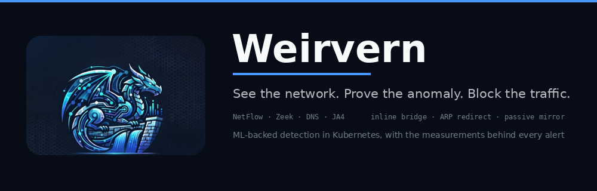
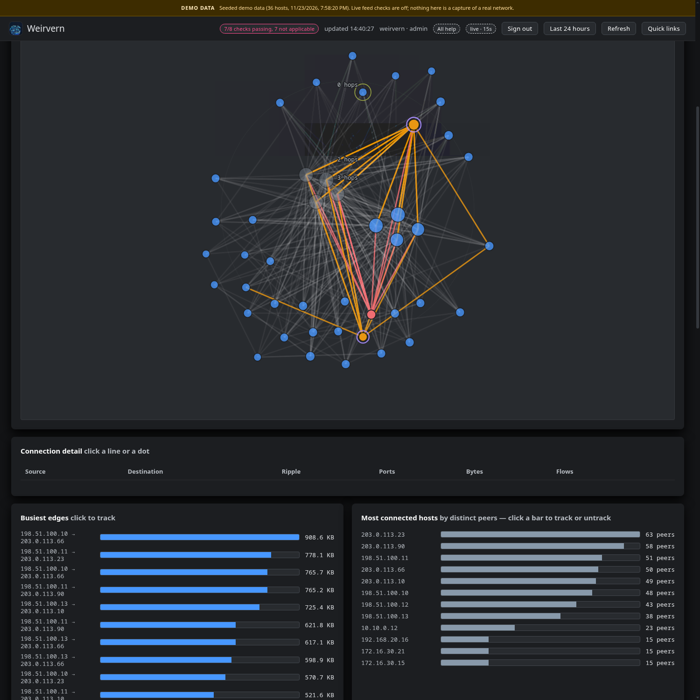
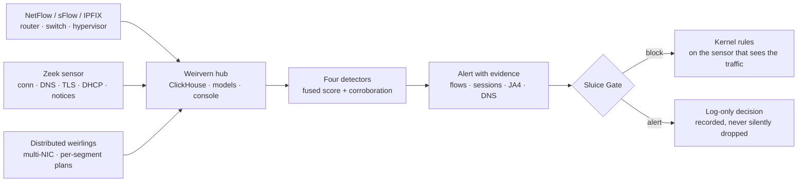

<p align="center">
  
</p>

<p align="center">
  ML-backed network detection and enforcement, <strong>built in Kubernetes for easy
  deployment</strong>. Weirvern learns from <strong>NetFlow, Zeek, DNS and JA4</strong>
  fingerprints, explains every alert with the measurements behind it, and can sit
  <strong>inline to inspect and drop traffic</strong>, redirect a segment with <strong>ARP</strong>,
  or watch passively from a mirror.
</p>

<p align="center">
  <code>inline bridge</code> · <code>ARP redirection</code> · <code>passive mirror</code> ·
  <code>distributed weirlings</code> · <code>NetFlow · Zeek · DNS · JA4</code> · <code>kernel blocking</code>
</p>

<p align="center">
  Current release: <strong>0.23.131</strong> · MIT · flow and protocol metadata only; payloads are never inspected
</p>

<p align="center">
  <a href="https://github.com/hodlhart/weirvern/actions/workflows/ci.yml"></a>
  <a href="https://github.com/hodlhart/weirvern/releases"></a>
  <a href="LICENSE"></a>
  <a href="https://kubernetes.io/"></a>
  <a href="SECURITY.md"></a>
</p>

<p align="center">
  <a href="#quick-start">Quick start</a> ·
  <a href="#screenshots">Screenshots</a> ·
  <a href="docs/architecture.md">Architecture</a> ·
  <a href="docs/deployment.md">Deploy</a> ·
  <a href="docs/detection.md">Detection</a> ·
  <a href="docs/operations.md">Operations</a>
</p>


## What you get

**An answer, not just an alert.** Every anomaly carries the measurements that produced it — the
z-scores, the baseline, the model votes and the raw flows, Zeek sessions, TLS records and DNS
answers behind the window. Click an alert and the evidence is on the same screen.

**Four detectors, one verdict.** Isolation Forest, Gradient Boosting, DBSCAN and a per-host
adaptive baseline are trained independently and fused into one score. A corroboration gate
decides when independent families and material evidence justify raising severity. A shadow
calibration layer and challenger channels measure false-alarm budgets and temporal evidence
without changing the alert path.

**Sensors where the network is.** A hub runs the database, models and the console; a weirling is
the sensor you place on a host or node anywhere in the infrastructure. It can carry several NICs,
each bound to a different segment with its own capture, redirect and blocking plan. See
[Weirlings: one hub, sensors throughout the infrastructure](#weirlings-one-hub-sensors-throughout-the-infrastructure).

**Inline when you need it.** Put two NICs in a bridge and the box becomes the wire: traffic
passes through, Zeek sees the protocol layer, and the Sluice Gate can drop a packet at the kernel.
No host agents, no SPAN port, no re-architecture. Or redirect a segment with ARP for a bounded
intercept, or stay passive on a mirror.

**Enforcement with a paper trail.** The Sluice Gate compiles rules to the kernel only where it can
actually see the traffic. Every block names its source, destination, direction, duration and
reason; every alerting decision — sent, suppressed or log-only — is recorded.

**Retention sized to the box, not to a hardcoded default.** The tables that feed detection and
the ripple baselines keep a window **derived from the free space on ClickHouse's disk and the
ingest rate those tables have actually measured** — 40% of free space by default, with the rest
kept as merge headroom, re-derived at startup and on every apply. An admin can override it for
7–365 days; a value above the measured budget is refused rather than allowed to fill the disk.

**No payload inspection.** Weirvern reads flow records and Zeek metadata. TLS still authenticates
end to end. Nothing is decrypted, and nothing is probed.

## Weirlings: one hub, sensors throughout the infrastructure

A weirling is a sensor, not a remote-agent afterthought. The hub can run with no capture NIC at
all; each weirling registers with it, reports its health, interfaces and flow feed, and receives
its own plan. Deploy as many as the infrastructure needs — one per rack, one per site, one per
isolated segment.

**Each NIC is planned independently.** A single weirling can have several NICs on different
segments, and each one carries its own roles:

- **capture** — mirror/SPAN/TAP traffic into Zeek for that segment
- **siphon** — ARP redirect on that NIC's segment, with its own routing table and gateway
- **sluice** — kernel blocking rules on that NIC, with its own nftables table pair
- **management** — refused for every active role, so the console path is never intercepted

One NIC's plan never overwrites another's. A weirling with one NIC on VLAN 21 and another on a
separate segment can watch one, redirect the other, or block on either independently. Add more
weirlings and the same per-NIC model extends across racks, sites and networks that do not route to
each other.

The fleet view keeps the facts separate: registered, silent, never-seen and revoked are different
states; every row shows its mode, networks, flow trend and NetFlow/Zeek feed indicators, with each
NIC's role on its own line. Revoking a weirling clears its plans and settings, so re-adopting it
starts clean rather than inheriting the old cross-segment roles.

## Screenshots

Every image is the shipping console rendered against synthetic, RFC 5737 documentation addresses.
No address from a real network appears in any screenshot.



The connection map is a deterministic force layout: nodes are hosts, edges are conversations,
size is bytes, and hop rings come from measured IP TTL where the export carries it. Click a node
to track it; click an edge for its exact source, destination and ports.

## How it works



The hub needs no capture NIC. A sensor can watch a copy (`loch`), redirect a segment with ARP
(`siphon`), or sit in-line as a bridge (`channel`). Only the in-path shapes can enforce; the
console says `degraded` rather than pretending when a mirror port cannot drop anything.

| Placement | What it needs | Can enforce? | Best for |
|---|---|---|---|
| **`loch`** — mirror / SPAN / TAP | 1 capture NIC, `NET_RAW` | No | Safe observation; the default |
| **`siphon`** — ARP redirect | 1 NIC on the segment, `NET_ADMIN` | Yes, while a supervised intercept is live | A flat segment or VLAN under investigation |
| **`channel`** — in-line bridge | 2 NICs (upstream + downstream), `NET_ADMIN` | Yes, continuously | A segment uplink you can route through the box |

The same image runs every shape; the placement is a setting, not an install. See
[Architecture](docs/architecture.md) for the full model and [Deployment](docs/deployment.md) for
the manifests, capabilities and checks.

## Product tour

- **Ripples** — the operator's reading surface. One row is one host and one hour in which
  independent families moved together, each against that host's own trailing history; open it for
  the evidence line per channel. The model's fused-score anomalies sit below the list as
  corroboration, never as the verdict.
- **Normalize** — a feed of near-similar flows and DNS that an operator reads, filters and marks
  as normal. Normalized traffic joins the host's adaptive baseline permanently, so the models
  learn it; nothing is silenced, and any claim can be undone.
- **Evidence** — the five-stage chain: observed, detected, explained, ruled, done. Block,
  acknowledge, resolve or ignore from the same page.
- **Network** — the connection map, busiest edges and per-host conversations.
- **Flows** — the raw NetFlow records with filterable fields, plus the DNS and Zeek feeds.
- **DNS** — questions and answers, the reverse map from an address to the names that pointed at
  it, and the blocklist state that governs port 53.
- **Sluice Gate** — rules split by block vs alert, live gate state, recent hits and domain
  blocklists managed from the console.
- **Blocked** — what the gate caught, which rule caught it, and the addresses a blocked domain
  currently resolves to.
- **Weirlings** — the fleet: registered, silent, never-seen and revoked are different facts, and
  each sensor's plan is edited in its own sheet. One row per weirling, one line per NIC, one
  plan per segment.
- **Logs** — every alerting decision at the top, then the write trail and the pipeline's own
  audit.

## Quick start

```sh
curl -fsSL https://raw.githubusercontent.com/hodlhart/weirvern/main/install.sh | sudo bash

# with in-path capability pre-provisioned (the mode is still switched in Settings):
curl -fsSL https://raw.githubusercontent.com/hodlhart/weirvern/main/install.sh | sudo bash -s -- --siphon
```

The installer creates the namespace, database, schema, workloads and the `weirvern-secrets`
Secret. The full procedure — requirements, refusal checks, the sensor's capture port and the
ConfigMap — is in [Deployment](docs/deployment.md).

The base install still exposes the console on plain HTTP NodePort `30088` for break-glass. The
supported local path is the HTTPS ingress: follow [`k8s/tls/README.md`](k8s/tls/README.md) once to
create the Weirvern local CA, install its root on the devices that will use the console, and
browse `https://sensor.example` (replace with your internal name). The certificate chains to the
Weirvern root and is renewed by cert-manager; no public CA or internet-facing port is involved.

Remote weirlings use the mTLS ingest gateway in [`k8s/mtls`](k8s/mtls/README.md): one-time
enrollment tokens, per-sensor client certificates, and no database credential on the sensor.
The gateway is part of the default install and `scripts/deploy-weirling.sh` adopts over mTLS by
default; `--legacy-clickhouse` is only for migrating a hub whose gateway is not reachable yet.

**Requirements:** a conformant Kubernetes cluster, a Linux sensor node for capture, and one of:
NetFlow/sFlow/IPFIX export, a SPAN/mirror port, or a TAP. The hub can run on the same node for a
lab, or separately for a production segment.

## Demo data

A fresh install is empty, and every query in the console is relative to now, so the dashboard
has nothing to show until traffic arrives. To fill it for a demo:

```sh
weirvern demo-seed                  # six days of traffic, ending at the current minute
weirvern demo-seed --dry-run        # print the row counts, write nothing
weirvern demo-seed --hours 6        # a quick fill, for a console that only needs traffic
```

That writes `zeek_conn` (117,325 rows), `zeek_dns` (23,325), `zeek_ssl` (22,988), `zeek_weird`
(5,427), `zeek_http` (23,377) and `flows` (117,325) for 22 simulated hosts, 309,767 rows in all.
Two properties are deliberate.

**The records go through the real mappers.** Every generated record is built in Zeek's own
field shape and pushed through `ingester.map_zeek_*`, the same functions the tailer calls. A
seeder that wrote finished rows would light up the console and leave the layer where ingestion
bugs actually live untested, and a test fails if the mapper stops being called.

**The flow view and the Zeek view come from the same conversations**, so the two channels
agree about volume instead of contradicting each other.

The data includes three anomalies on purpose, and they are graded rather than decorative.

A steady small beacon to one external address every window, which a per-host volume baseline will
not flag on size. One port sweep with high flow count and almost no bytes, which the diversity and
volume models read differently. And, in the final hour, one host whose flows and DNS lookups run
tens of times above anything it has done before, which is the only one of the three the Ripples
card can see.

That last one is deliberate arithmetic. A ripple needs two families to clear p <= 0.01 on the same
host in the same window, the p-value is empirical against the host's own past, and the evidence
measures the current hour only. So the burst has to land in the final hour and beat every hour the
host has had; 0.006 is "more extreme than all 167 baseline windows", and nothing subtle reaches it.
Without this the demo fills 300,000 rows and still shows an empty Ripples card, which reads as a
broken feature and is really a seed that asked too little of itself. Measured on a seeded
database: `combined_p` 4.3e-05 across three families, one ripple.

**It is generated, not a capture.** `--seed` makes it reproducible, and nothing is derived from
real traffic. If you have your own capture and want genuine packets, replay it instead:

```sh
tcpreplay --intf eth1 --topspeed capture.pcap
```

Three caveats, all measured on this codebase. The capture's timestamps are its own, so a
capture from last week lands outside every `now()` window and renders an empty dashboard until
you shift it with `tcprewrite`. Replay needs capture privileges on the interface, which a
container usually does not have. And `--topspeed` can outrun Zeek, which shows up as
`capture_loss` rather than as a clean demo.

### What a seeded install contains

The point of the command is a console someone can take for a test drive, so it fills the surfaces a
reader opens first rather than only the traffic tables.

| Surface | What is there after one run |
| --- | --- |
| Ripples | Two incidents of different shapes, both high severity, four families each |
| Sluice | One traffic block on a host, one DNS block on a name, each with the hits it caught |
| Gate | Armed, reporting the two live rules and the packets those hits blocked |
| Approvals | One block proposal waiting for a decision, with its reason and evidence |
| Blocklists | Five sources and the blocked name on the custom list |
| Network and Assets | All 22 hosts classified, with MAC, vendor and an operating system guess |
| Normalized | One value marked expected, with a reason and a review date |

Both kinds of block matter. Blocking a host and blocking a name are different products: the first
stops traffic to an address, the second removes the rendezvous, and a seed with only one of them
leaves half the Sluice page empty.

**The normalized entry is a reading, not an invention.** Detection's other half is teaching the
console what is ordinary: a backup job, a vendor's update service, a printer that speaks one ancient
protocol. Left alone those fire on every pass and teach the operator to ignore the page. The seeder
asks each signature-capable channel for the exact values this host actually sent and marks the
busiest one expected, so the row names something real. Measured on a seeded database: with the
signature the host's destination diversity is 3 distinct values, and removing it makes the same
measurement read 4.

**The gate is armed in the record only.** Nothing here touches nftables or the kernel, so a seeded
laptop cannot accidentally block its own network. What the gate row says is what the console reads.

**What it does not fill, and why.** The asset-posture bands and the detector calibrations are
produced by the worker's shadow passes, so they stay empty until the worker has run over the seeded
data. That is the honest state of a fresh install and the panels say so; a seeded score would be a
number no model produced.

### Why the default is six days

The Ripples card is built from evidence measured against each host's own recent past, and it has a
floor: a scale is only measured when the host has at least 30 baseline windows behind it. At the
hourly scale that is about 30 hours of history, so a six-hour seed fills every table and still
shows an empty Ripples card, which looks exactly like a broken feature. Six days clears the floor
with room to spare and stays inside the seven-day lookback.

The seeder runs that evidence pass itself, because the worker only does it on its shadow tick and
a demo should not wait for one. `--no-evidence` skips it.

### Scope

Every seeded host sits in `192.0.2.0/24`. The console treats an address as ours only when a
monitored network in `network_scopes` covers it, and an address that is not ours is a peer with no
evidence measured against it. So with no covering scope the Ripples card is empty for a scope
reason, which is a correct absence that an audience reads as a broken card.

The seeder reports that gap and stops there, because that table also decides what the scanner is
allowed to touch and a demo seeder must not widen it quietly. Re-run with `--scope` to declare
`192.0.2.0/24` as monitored, or add it under Settings > Networks.

**After seeding, let the worker run one sweep.** The derived tables the ML panels read
(`flows_window`, `ml_window_scores`) are produced by the normal detection loop, not by the
seeder, so those panels stay empty until a sweep completes over the new data. This does not apply
to the aggregate views, which are materialized views on `flows` and fill as the seed inserts.

The seeder refuses to run when recent flow data exists, because mixing demo rows into a working
install is not recoverable by deleting rows you can no longer identify. `--force` overrides it
when that is genuinely what you want.

### The deployment Secret

The installer creates `weirvern-secrets` for you. By hand it is one command — the ClickHouse
password, break-glass operator token, and Pushover credentials (empty by default, which selects
log-only alerting):

```sh
kubectl -n weirvern create secret generic weirvern-secrets \
  --from-literal=CLICKHOUSE_PASSWORD="$(openssl rand -base64 24)" \
  --from-literal=WEIRVERN_GUI_TOKEN="$(openssl rand -base64 24)" \
  --from-literal=WEIRVERN_FLASK_SECRET="$(openssl rand -base64 32)" \
  --from-literal=PUSHOVER_USER_KEY='' \
  --from-literal=PUSHOVER_API_TOKEN=''
```

Read the break-glass token again with:

```sh
kubectl -n weirvern get secret weirvern-secrets -o jsonpath='{.data.WEIRVERN_GUI_TOKEN}' | base64 -d
```

The dashboard also needs `WEIRVERN_FLASK_SECRET`, which signs its session cookie and is declared on
the GUI container as a required key: a Secret without it refuses to start that pod and names the key,
rather than serving a login page that reads "the rendered UI is disabled" while the pod reports
Ready. An install from before the switch must add it, and restart the pod so it takes effect (a
Secret reaches the process at container start):

```sh
kubectl -n weirvern patch secret weirvern-secrets --type merge \
  -p "{\"data\":{\"WEIRVERN_FLASK_SECRET\":\"$(openssl rand -base64 32 | base64 -w0)\"}}"
kubectl -n weirvern rollout restart deploy/weirvern-gui
kubectl -n weirvern exec deploy/weirvern-gui -- printenv WEIRVERN_FLASK_SECRET
```

The restart is not tidiness: a Secret's values reach the process at container start, so the running
pod keeps the environment it booted with until it restarts, and the second command proves the new
value is in it.

The dashboard itself runs on Flask behind waitress, with every API route served by that app; nothing
is proxied to an older handler.

### API tokens

The operator token above is the deployment's **break-glass** credential: one value, admin
everywhere, and independent of everything else so it can recover a broken deployment. For
day-to-day automation, an admin signs in and mints a **per-token credential** under
**Settings → Access and security → API tokens**. Each token:

- carries one role — `admin` (read and write, like an admin account) or `viewer` (read only);
- is revoked on its own, and the next request presenting it is refused — no restart;
- is recorded in the audit trail by name when it is minted or revoked, never by value;
- cannot mint or revoke another token. That requires a signed-in admin **session**, so a leaked
  token cannot outlive its own revocation.

The secret is shown **once**, in the create response. The store keeps only its SHA-256 digest and
an eight-character prefix for the list, so a lost token is revoked and replaced, never recovered.
Tokens live in a `weirvern-tokens` ConfigMap created on first mint; the GUI's ServiceAccount is
already scoped to patch `weirvern-env`, `weirvern-users` and `weirvern-tokens` by name.

## Security and trust

- **No payload inspection.** Flow metadata and Zeek protocol logs only; TLS is never decrypted.
- **Break-glass access is explicit.** The GUI token is a Secret, not a URL parameter; sessions
  and roles are recorded. Per-token credentials are individually revocable, role-scoped, and
  stored as digests.
- **Every write is audited.** Settings, plans, revocations and rules carry actor, time and reason.
- **Fail-open by default.** A sensor that cannot enforce says so; the siphon watchdog restores
  every mapping on stop, crash or a stalled forward.
- **Your data stays yours.** No telemetry, no cloud dependency, no phone-home.

Read [Security and privacy](docs/security.md) and [USAGE_POLICY.md](USAGE_POLICY.md). This tool is
for networks you own or are explicitly authorized to monitor.

## Documentation

- [Architecture](docs/architecture.md) — workloads, sensor modes, the channel, TLS
- [Theme](docs/theme.md) — the console's visual system and component recipes
- [Deployment](docs/deployment.md) — requirements, install, verify, upgrade, remove
- [Detection and alerting](docs/detection.md) — the ensemble, alert hygiene
- [Portable ML](docs/portable-ml.md) — local warm-up, invariant features and per-network calibration
- [Asset scanner](docs/scanner.md) — Nmap inventory, the change ledger and the shadow posture model
- [Flow direction](docs/design/flow-direction.md) — request/reply evidence in the Flows tab
- [Trunk ports](docs/design/trunk-default.md) — adaptive VLAN devices, the default topology
- [Remote weirling gaps](docs/weirling-remote-gaps.md) — what a remote sensor still cannot do
- [Operations](docs/operations.md) — CLI, lifecycle, backups, key settings, troubleshooting
- [Security and privacy](docs/security.md) — privileges, RBAC, data sensitivity, exposure
- [Development](docs/development.md) — repository layout, tests and the gate
- [Branding](docs/README.md) — the project mark and favicon regeneration

## License

MIT — see [LICENSE](LICENSE). Third-party components and their licenses are listed in
[NOTICE](NOTICE).
